# Lattice Dynamics and Phonon Dispersion

A Python learning project that connects harmonic interatomic forces to normal
modes, phonon dispersion relations, and the phonon density of states (DOS).
The calculations start from real-space force constants and solve the
mass-normalized eigenvalue problem with NumPy. Analytical solutions and physical
constraints provide independent checks of the numerical results.

The project covers one-dimensional monatomic and diatomic chains and the
in-plane vibrations of a two-dimensional square lattice. It includes a reusable
solver, convergence studies, and 12 PNG figures generated with Matplotlib.

## Contents

- [Features](#features)
- [Installation](#installation)
- [Quick start](#quick-start)
- [Project structure](#project-structure)
- [Notation and units](#notation-and-units)
- [From force constants to normal modes](#from-force-constants-to-normal-modes)
- [Monatomic chain](#monatomic-chain)
- [Diatomic chain](#diatomic-chain)
- [Two-dimensional square lattice](#two-dimensional-square-lattice)
- [Phonon density of states](#phonon-density-of-states)
- [Using the numerical modules](#using-the-numerical-modules)
- [Numerical validation](#numerical-validation)
- [Generated figures](#generated-figures)
- [Scope and limitations](#scope-and-limitations)
- [Contributing](#contributing)
- [License](#license)

## Features

| Component | What it demonstrates |
| --- | --- |
| Monatomic chain | One acoustic branch, analytical dispersion, finite periodic-chain comparison, and parameter scaling |
| Diatomic chain | Acoustic and optical branches, mass-weighted eigenvectors, equal-mass zone folding, and mass-ratio dependence |
| General solver | Force-constant validation, Fourier assembly, Hermitian diagonalization, and numerical diagnostics |
| Square lattice | Central-force interactions, shear zero modes, diagonal-spring stabilization, and a high-symmetry path |
| Phonon DOS | Full-zone sampling, Gaussian broadening, branch contributions, mode counting, and convergence checks |
| Visualization | Separate figure windows and automatic 300 dpi PNG export to `results/figures/` |

The learning sequence follows the same order: understand a simple model,
verify its analytical solution, extract the general numerical method, and then
apply it to a higher-dimensional model and its DOS.

## Installation

### Requirements

- Python **3.10 or newer**.
- NumPy **2.2.6** and Matplotlib **3.10.9**, pinned in
  [requirements.txt](requirements.txt).
- A CPU is sufficient; no GPU or external lattice-dynamics software is required.

The pinned dependencies were used to verify the calculations and figures.

### Set up an environment

Download or clone the repository, open a terminal in its root directory, and
create a virtual environment:

```bash
python -m venv .venv
```

Activate it on macOS or Linux:

```bash
source .venv/bin/activate
```

Or activate it in Windows PowerShell:

```powershell
.venv\Scripts\Activate.ps1
```

Install the dependencies:

```bash
python -m pip install -r requirements.txt
```

This repository uses modules in the project root. Run the commands and Python
examples below from that directory; a package installation is not needed.

## Quick start

Run the examples in the following order:

```bash
python monatomic_chain.py
python diatomic_chain.py
python square_lattice.py
python phonon_dos.py
```

Each script performs its built-in checks, prints numerical diagnostics, saves
its figures, and then calls `plt.show()`. With an interactive Matplotlib backend,
close the figure windows to let the script finish. The DOS example also performs
mesh-convergence calculations and therefore takes longer than the chain examples.

The general solver has two additional console demonstrations:

```bash
python dynamical_matrix.py
python dispersion.py
```

These print mode information, result shapes, and residuals without generating
figures.

For a terminal without a graphical display, use the noninteractive backend.
For example, on macOS or Linux:

```bash
MPLBACKEND=Agg python phonon_dos.py
```

Or in Windows PowerShell:

```powershell
$env:MPLBACKEND = "Agg"
python phonon_dos.py
```

The PNG output is the same type of output in either mode. The destination is
resolved relative to the source files, so it does not depend on the terminal's
working directory. Existing figures with the same filenames are overwritten.

## Project structure

```text
.
├── README.md
├── requirements.txt
├── monatomic_chain.py       # Analytical and numerical monatomic-chain example
├── diatomic_chain.py        # Diatomic modes, zone folding, and mass-ratio study
├── dynamical_matrix.py      # Model data, force validation, and normal-mode solver
├── dispersion.py            # Normal modes along arbitrary wavevector arrays
├── square_lattice.py        # Square-lattice models, path, checks, and plots
├── dos.py                   # Reciprocal meshes, Gaussian DOS, and integration
├── phonon_dos.py            # DOS studies, convergence checks, and five figures
├── visualization.py         # Shared PNG export helper
└── results/
    └── figures/             # 12 generated PNG figures
```

The repository contains computational code, plotting, and checks inside the
scripts. It does not contain a separate test suite.

## Notation and units

| Symbol | Meaning | Code convention |
| --- | --- | --- |
| $a$ | Primitive-cell length | `lattice_constant` |
| $m$, $m_1$, $m_2$ | Atomic masses | `mass`, `mass_1`, `mass_2` |
| $K$ | Chain spring constant | `spring_constant` |
| $K_1$ | Axial square-lattice spring constant | `nearest_neighbor_spring_constant` |
| $K_2$ | Diagonal square-lattice spring constant | `diagonal_spring_constant` |
| $\mathbf R_l$ | Translation of primitive cell $l$ | Integer cell index multiplied by `lattice_vectors` |
| $\boldsymbol\tau_\kappa$ | Equilibrium position within a cell | `basis_positions` |
| $\mathbf q$ | Cartesian wavevector | `wavevector` or `wavevectors` |
| $\Phi$ | Real-space force-constant matrix | `force_constants` |
| $D(\mathbf q)$ | Mass-normalized dynamical matrix | `build_dynamical_matrix(...)` |
| $\lambda_s$ | Squared angular frequency, $\omega_s^2$ | `eigenvalues` |
| $\mathbf e_s$ | Mass-weighted unit eigenvector | Columns of `eigenvectors` |
| $\sigma$ | Gaussian standard deviation for DOS broadening | `broadening_width` |

All frequencies are **angular frequencies**. Ordinary frequency is
$f=\omega/(2\pi)$.

The examples use fixed reference units $m_0$, $K_0$, and $a_0$, with

$$
\omega_0=\sqrt{K_0/m_0}.
$$

Numerical masses, stiffnesses, lengths, and wavevectors are expressed in units of
$m_0$, $K_0$, $a_0$, and $a_0^{-1}$, respectively. Plots show
$\omega/\omega_0$ and, for chains, $qa/\pi$. The reference units remain fixed
when a model parameter changes, so mass and stiffness scaling remain visible.
The reference speed is $a_0\omega_0$.

For the diatomic chain, **$a$ is the cell length**; the nearest-neighbor atomic
spacing is $a/2$. All model constructors require positive masses and positive
nearest-neighbor stiffnesses. The square-lattice diagonal stiffness may be zero.

## From force constants to normal modes

### Harmonic approximation

Let $u_{l\kappa\alpha}$ be the displacement of basis atom $\kappa$ in cell $l$
along Cartesian direction $\alpha$. Expanding the potential around an
equilibrium configuration gives

$$
V=V_0+\frac12\sum_{l\kappa\alpha,l'\kappa'\beta}
u_{l\kappa\alpha}
\Phi_{\kappa\alpha,\kappa'\beta}(\mathbf R_{l'}-\mathbf R_l)
u_{l'\kappa'\beta}.
$$

The first derivative vanishes at equilibrium. The force constants are the
second derivatives of the potential, and the force is

$$
F_{l\kappa\alpha}
=-\sum_{l'\kappa'\beta}
\Phi_{\kappa\alpha,\kappa'\beta}(\mathbf R_{l'}-\mathbf R_l)
u_{l'\kappa'\beta}.
$$

Thus the sign of an off-diagonal force constant follows from the derivative
of the potential; it is not a separately chosen force sign.

### Bloch ansatz and mass normalization

The code uses the **cell-phase convention**:

$$
u_{l\kappa\alpha}(t)
=\frac{e_{\kappa\alpha}(\mathbf q)}{\sqrt{m_\kappa}}
e^{i(\mathbf q\cdot\mathbf R_l-\omega t)}.
$$

Physical displacements are the real part of this expression, with an arbitrary
overall mode amplitude. Substituting into Newton's equations yields

$$
D(\mathbf q)\mathbf e_s(\mathbf q)
=\omega_s^2(\mathbf q)\mathbf e_s(\mathbf q),
$$

where

$$
D_{\kappa\alpha,\kappa'\beta}(\mathbf q)
=\frac{1}{\sqrt{m_\kappa m_{\kappa'}}}
\sum_{\mathbf R}
\Phi_{\kappa\alpha,\kappa'\beta}(\mathbf R)
e^{i\mathbf q\cdot\mathbf R}.
$$

Mass normalization turns the generalized equation
$\Phi(\mathbf q)\mathbf U=\omega^2 M\mathbf U$ into an ordinary Hermitian
eigenvalue problem. A cell containing $n$ atoms with $d$ displacement components
per atom has $\nu=nd$ branches. In this project, $d$ is also the spatial dimension.

The Fourier phase contains only cell translations. `basis_positions` records the
geometry but is not added to that phase, and the solver does not infer force
constants from those positions. A convention that also includes basis positions
changes eigenvector phases through a unitary transformation while preserving
the frequencies.

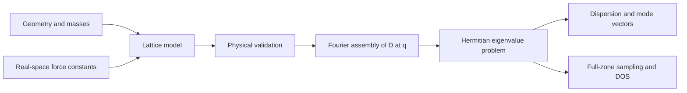

### Physical constraints

The solver checks force-constant reciprocity,

$$
\Phi_{\kappa\alpha,\kappa'\beta}(\mathbf R)
=\Phi_{\kappa'\beta,\kappa\alpha}(-\mathbf R),
$$

and the acoustic sum rule,

$$
\sum_{\mathbf R,\kappa'}
\Phi_{\kappa\alpha,\kappa'\beta}(\mathbf R)=0
\quad\text{for every }\kappa,\alpha,\beta.
$$

The sum rule expresses invariance under a uniform displacement. At
$\Gamma$ ($\mathbf q=0$), the mass-weighted translation vector in direction
$\beta$ has components

$$
t^{(\beta)}_{\kappa\alpha}
\propto\sqrt{m_\kappa}\,\delta_{\alpha\beta},
\qquad D(0)\mathbf t^{(\beta)}=0.
$$

For unequal masses, this condition does not require the ordinary row sums of
$D(0)$ to vanish. Each Cartesian translation direction must be checked
independently.

## Monatomic chain

### Model and derivation

Each primitive cell contains one mass $m$, with longitudinal displacement
$u_n$. Identical springs of stiffness $K$ connect nearest neighbors separated
by $a$:

```text
... --K-- (m, u[n-1]) --K-- (m, u[n]) --K-- (m, u[n+1]) --K-- ...
                          <--- a --->
```

Count each bond once in the potential:

$$
V=\frac K2\sum_n(u_{n+1}-u_n)^2.
$$

Differentiating gives

$$
m\ddot u_n=K(u_{n+1}+u_{n-1}-2u_n).
$$

The atom participates in a left bond and a right bond. Each contributes $K$
to the second derivative with respect to $u_n$, so

$$
\Phi(0)=2K,\qquad\Phi(+a)=\Phi(-a)=-K.
$$

This explains the onsite value **$2K$**. It accounts for both bonds attached to
the atom, even though each bond occurs only once in the total potential.

Using $u_n=Ae^{i(qna-\omega t)}$ gives

$$
D(q)=\frac{2K-Ke^{iqa}-Ke^{-iqa}}m
=\frac{4K}{m}\sin^2\left(\frac{qa}{2}\right),
$$

and therefore

$$
\boxed{\omega(q)=2\sqrt{K/m}\left|\sin\left(\frac{qa}{2}\right)\right|.}
$$

There is one displacement degree of freedom per cell and hence one branch.
It is acoustic because its frequency vanishes at $q=0$.

### Is the wavevector continuous or discrete?

For an infinite periodic chain, $q$ is continuous within a Brillouin zone.
Wavevectors differing by $2\pi/a$ are equivalent, so the first zone can be
represented by $[-\pi/a,\pi/a)$.

For a finite chain of $N$ cells with periodic boundary conditions,

$$
u_{n+N}=u_n
\quad\Longrightarrow\quad
e^{iqNa}=1
\quad\Longrightarrow\quad
q_j=\frac{2\pi j}{Na}.
$$

There are $N$ distinct allowed wavevectors modulo the reciprocal period.
The script uses **100 atoms** for the finite-chain verification and **401
wavevector samples** to draw the continuous dispersion. These counts serve
different purposes and need not agree. The two endpoints of the plotting
interval are equivalent and are both shown to complete the curve; DOS meshes
exclude the duplicate endpoint.

### Results and interpretation

The default example uses $m=K=a=1$. It predicts

| Wavevector | Frequency $\omega/\omega_0$ | Interpretation |
| --- | --- | --- |
| $0$ | $0$ | Uniform translation |
| $\pi/(2a)$ | $\sqrt{2}$ | Intermediate wavelength |
| $\pi/a$ | $2$ | Neighboring atoms oscillate in opposite phase |

In the long-wavelength limit,

$$
\omega(q)\simeq c|q|,\qquad c=a\sqrt{K/m}.
$$

The frequency scales as $m^{-1/2}$ and $K^{1/2}$. Changing $a$ changes the
long-wavelength slope at fixed physical $q$; at fixed $qa$, it does not change
the frequency for this model.

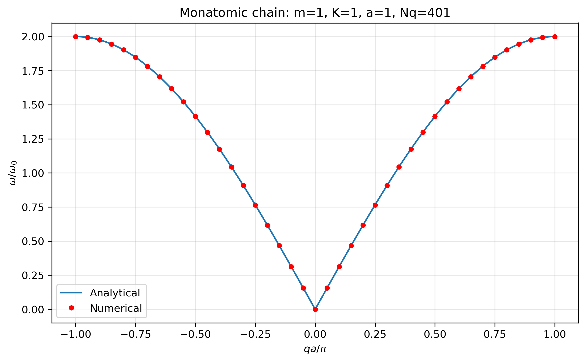

*The continuous analytical curve and the sampled numerical eigenfrequencies
agree. The numerical route assembles the force-constant Fourier sum before
diagonalization.*

<details>
<summary>Show the monatomic-chain absolute frequency error</summary>

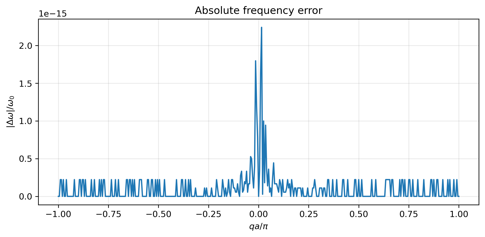

*Absolute error is appropriate near zero frequency, where a relative error
would be undefined or misleading.*

</details>

## Diatomic chain

### Model and dynamical matrix

Each cell of length $a$ contains masses $m_1$ and $m_2$ at positions $0$ and
$a/2$. Equal springs $K$ connect adjacent atoms:

```text
... --K-- (m1, cell n) --K-- (m2, cell n) --K-- (m1, cell n+1) --K-- ...
          |<---------------- a ---------------->|
```

The potential and equations of motion are

$$
V=\frac K2\sum_n
\left[(u_{n2}-u_{n1})^2+(u_{n+1,1}-u_{n2})^2\right],
$$

$$
\begin{aligned}
m_1\ddot u_{n1}&=K(u_{n2}+u_{n-1,2}-2u_{n1}),\\
m_2\ddot u_{n2}&=K(u_{n1}+u_{n+1,1}-2u_{n2}).
\end{aligned}
$$

With the cell-phase convention, the mass-normalized matrix is

$$
D(q)=
\begin{pmatrix}
\dfrac{2K}{m_1}&
-\dfrac{K(1+e^{-iqa})}{\sqrt{m_1m_2}}\\
-\dfrac{K(1+e^{iqa})}{\sqrt{m_1m_2}}&
\dfrac{2K}{m_2}
\end{pmatrix}.
$$

The off-diagonal entries are complex conjugates. Two longitudinal degrees
of freedom per cell produce two branches.

### Acoustic and optical eigenvalues

Set $\lambda=\omega^2$. Expanding $\det(D-\lambda I)=0$ gives

$$
\lambda^2
-2K\left(\frac1{m_1}+\frac1{m_2}\right)\lambda
+\frac{4K^2}{m_1m_2}\sin^2\left(\frac{qa}{2}\right)=0.
$$

Define

$$
B=K\left(\frac1{m_1}+\frac1{m_2}\right),\qquad
C=\frac{4K^2}{m_1m_2}\sin^2\left(\frac{qa}{2}\right).
$$

Then

$$
\boxed{\omega_\pm^2=B\pm\sqrt{B^2-C}.}
$$

The minus sign is the acoustic branch and the plus sign is the optical
branch. Near $\Gamma$, evaluating $B-\sqrt{B^2-C}$ directly subtracts two
nearly equal numbers. The analytical implementation instead uses

$$
\omega_-^2=\frac{C}{\omega_+^2},
$$

and evaluates the discriminant in the equivalent form

$$
B^2-C=
K^2\left(\frac1{m_1}-\frac1{m_2}\right)^2
+\frac{4K^2}{m_1m_2}\cos^2\left(\frac{qa}{2}\right).
$$

At $\Gamma$, the acoustic mode has equal physical displacements,
$U_1=U_2$. The optical mode satisfies $m_1U_1+m_2U_2=0$, or
$U_2/U_1=-m_1/m_2$. These relations apply to physical displacements
$\mathbf U=M^{-1/2}\mathbf e$, rather than directly to the mass-weighted
eigenvectors.

### Results and mass-ratio dependence

For the default $m_1=1$, $m_2=2$, $K=a=1$:

| Point | Acoustic frequency | Optical frequency |
| --- | --- | --- |
| $\Gamma$ | $0$ | $\sqrt{3}$ |
| $q=\pi/a$ | $1$ | $\sqrt{2}$ |

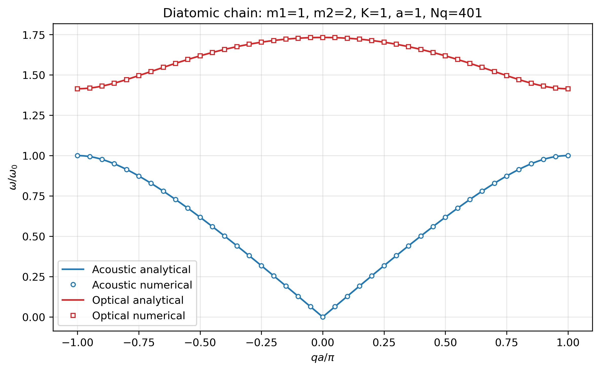

*The lower branch describes long-wavelength sound. The upper branch remains
at a finite frequency at $\Gamma$ because the two basis atoms move against
one another.*

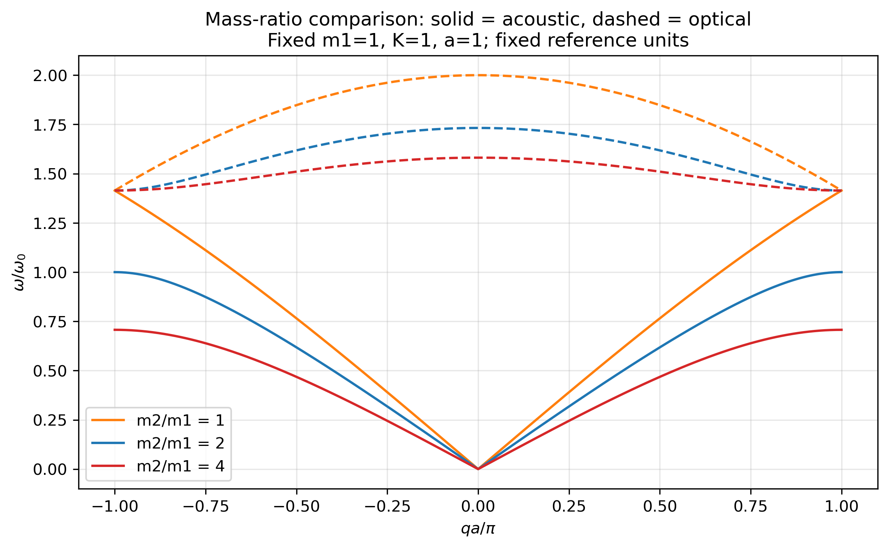

*With $m_1$, $K$, and $a$ fixed and $m_2/m_1=1,2,4$, increasing the second
mass lowers the acoustic band edge and widens the frequency gap. For these
ratios, the optical frequency at the zone boundary stays at
$\sqrt{2K/m_1}$.*

When $m_1=m_2$, the gap closes. The two branches are the monatomic dispersion
folded into the smaller Brillouin zone of a cell of length $a$; the underlying
monatomic spacing is $a/2$. The script checks this equal-mass limit explicitly.

<details>
<summary>Show the diatomic-chain absolute frequency errors</summary>

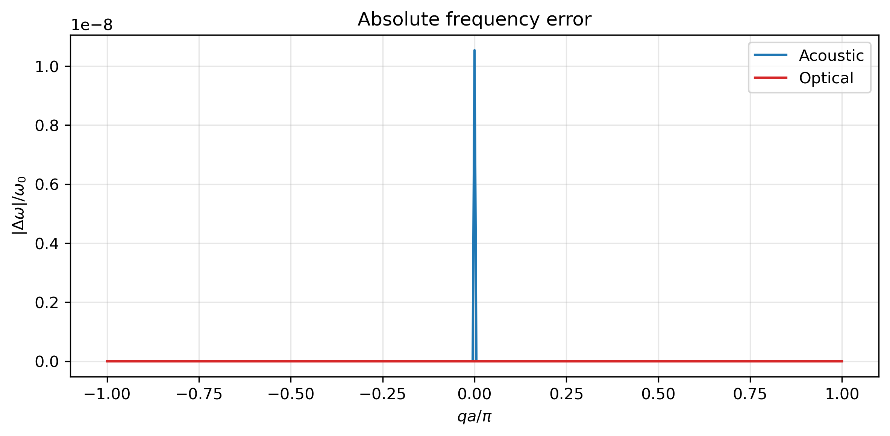

*Taking a square root amplifies small eigenvalue errors near zero. An
eigenvalue error near machine precision can therefore produce a larger
absolute frequency error at $\Gamma$ without indicating a wrong dispersion.*

</details>

## Two-dimensional square lattice

### Central springs and bond stiffness

The square lattice contains one atom of mass $m$ per cell, with two in-plane
displacement components. Axial nearest-neighbor bonds have stiffness $K_1$.
Optional bonds along both diagonals have stiffness $K_2$.

For an unstrained central spring with unit bond direction $\hat{\mathbf n}$,

$$
V_{ij}=\frac K2
\left[\hat{\mathbf n}\cdot(\mathbf u_j-\mathbf u_i)\right]^2.
$$

Its stiffness block is

$$
C_{ij}=K\hat{\mathbf n}\hat{\mathbf n}^{\mathsf T}.
$$

The onsite block receives $+C_{ij}$ and the corresponding coupling block
receives $-C_{ij}$. A spring constrains the component along its bond at
harmonic order. Replacing this block by $KI$ would describe a different model.

For the two diagonal orientations,

$$
C_+=\frac{K_2}{2}
\begin{pmatrix}1&1\\1&1\end{pmatrix},\qquad
C_-=\frac{K_2}{2}
\begin{pmatrix}1&-1\\-1&1\end{pmatrix}.
$$

The factor $1/2$ comes from normalizing the diagonal bond directions.

### Nearest-neighbor model: $K_2=0$

Fourier assembly gives

$$
D(\mathbf q)=\frac{2K_1}{m}
\begin{pmatrix}
1-\cos(q_xa)&0\\
0&1-\cos(q_ya)
\end{pmatrix}.
$$

The coordinate-polarized frequencies are

$$
\omega_x=2\sqrt{K_1/m}|\sin(q_xa/2)|,\qquad
\omega_y=2\sqrt{K_1/m}|\sin(q_ya/2)|.
$$

Along $\Gamma\rightarrow X$, $q_y=0$, so the $y$-polarized branch is zero
along the entire segment. The central-force nearest-neighbor model has no
harmonic shear stiffness. This extra zero-frequency branch follows from
the model and is retained in the calculation.

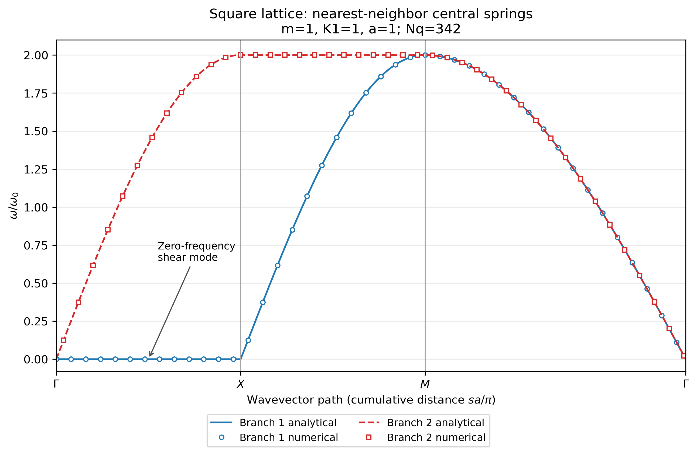

### Adding diagonal springs: $K_2>0$

Writing $x=q_xa$ and $y=q_ya$, the matrix becomes

$$
D(\mathbf q)=\frac2m
\begin{pmatrix}
K_1(1-\cos x)+K_2(1-\cos x\cos y)&K_2\sin x\sin y\\
K_2\sin x\sin y&K_1(1-\cos y)+K_2(1-\cos x\cos y)
\end{pmatrix}.
$$

The diagonal springs restore shear stiffness. Both branches remain acoustic
and vanish at $\Gamma$. Along the positive $q_x$ axis near $\Gamma$,

$$
\omega_T\simeq c_Tq_x,\qquad c_T=a\sqrt{K_2/m},
$$

$$
\omega_L\simeq c_Lq_x,\qquad c_L=a\sqrt{(K_1+K_2)/m}.
$$

These speeds are directional; the model need not be elastically isotropic.

The example compares $K_2=0$ and $K_2=0.25$ at $m=K_1=a=1$ along

$$
\Gamma=(0,0)\rightarrow
X=(\pi/a,0)\rightarrow
M=(\pi/a,\pi/a)\rightarrow\Gamma.
$$

The horizontal axis is cumulative Cartesian wavevector distance, scaled by
$a/\pi$. The $M\rightarrow\Gamma$ segment is $\sqrt{2}$ times longer than
each axial segment. Neighboring segments do not repeat their shared endpoints.

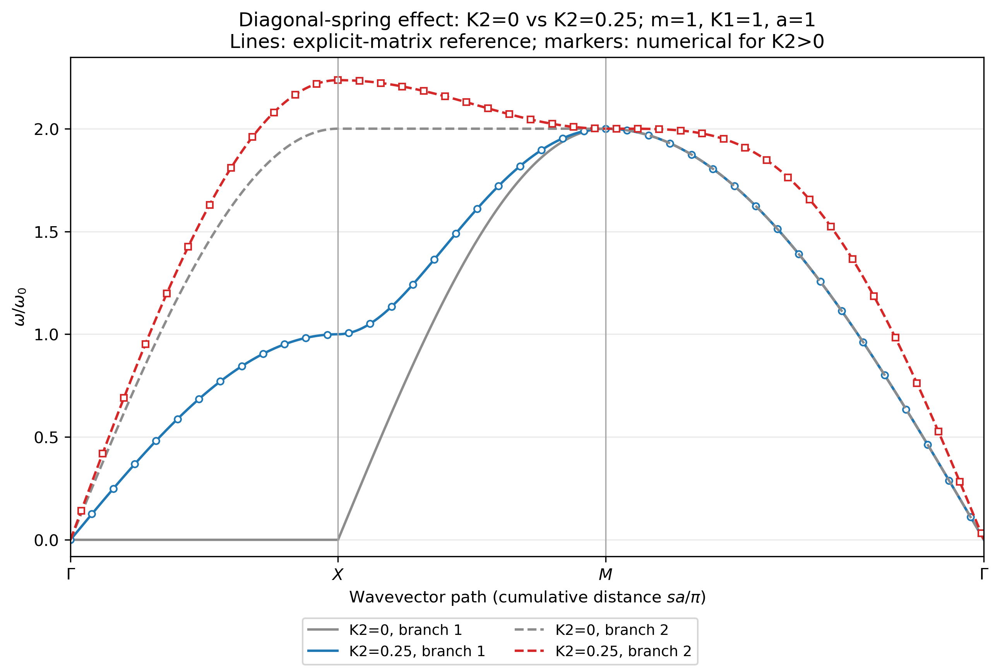

*The stabilized model lifts the extra shear zero modes while preserving the
two translation zero modes at $\Gamma$. Numerical markers are compared with
an independently evaluated closed-form matrix.*

For $K_2=0.25$, the expected special-point eigenvalues are

| Point | Eigenvalues $\lambda/\omega_0^2$ | Frequencies $\omega/\omega_0$ |
| --- | --- | --- |
| $\Gamma$ | $0,0$ | $0,0$ |
| $X$ | $1,5$ | $1,\sqrt{5}$ |
| $M$ | $4,4$ | $2,2$ |

The general solver sorts branches by frequency independently at each
wavevector. Labels such as “branch 1” and “branch 2” therefore do not guarantee
continuous polarization tracking across crossings or degeneracies.

## Phonon density of states

### Definition and full-zone sampling

The DOS counts modes per primitive cell per unit angular frequency:

$$
g(\omega)=\frac1{V_{\mathrm{BZ}}}
\sum_{s=1}^{\nu}\int_{\mathrm{BZ}}
\delta\left(\omega-\omega_s(\mathbf q)\right)\,d^d q.
$$

Here $V_{\mathrm{BZ}}$ denotes Brillouin-zone length in one dimension or
area in two dimensions. With normalized wavevector weights $w_i$,

$$
g(\omega)\approx
\sum_iw_i\sum_{s=1}^{\nu}
\delta\left(\omega-\omega_s(\mathbf q_i)\right),
\qquad\sum_iw_i=1.
$$

Consequently,

$$
\int_0^\infty g(\omega)\,d\omega=\nu
$$

for the exact, unbroadened DOS, with zero-frequency modes counted in full.
The expected count is **1** for the monatomic chain and **2** for the
diatomic chain and the in-plane square lattice.

A high-symmetry path samples only selected directions and cannot supply the
zone average. DOS calculations instead use a uniform reciprocal-cell mesh.
If the rows of $A$ are real-space lattice vectors, the reciprocal vectors are
the rows of

$$
B=2\pi A^{-\mathsf T},\qquad\mathbf q=\mathbf fB,
\quad f_\alpha\in[-1/2,1/2).
$$

For the models here, this mesh covers the first Brillouin zone. For an oblique
lattice, the same construction covers an equivalent reciprocal primitive
cell, which is suitable for periodic integrals.

### Gaussian broadening and normalization

The delta functions are replaced by Gaussian kernels,

$$
G_\sigma(\omega-\Omega)=
\frac1{\sqrt{2\pi}\sigma}
\exp\left[-\frac{(\omega-\Omega)^2}{2\sigma^2}\right],
$$

giving

$$
g_\sigma(\omega)=\sum_iw_i\sum_s
G_\sigma\left(\omega-\omega_s(\mathbf q_i)\right).
$$

An ordinary Gaussian is normalized on the **full real axis**. Kernels near
zero place part of their area at negative frequencies. The code therefore
uses a grid spanning $[-5\sigma,\omega_{\max}+5\sigma]$ by default and checks
the integral over that complete grid. The grid spacing is at most
$\sigma/5$.

The negative-frequency tail is a broadening artifact; it does not represent
an unstable mode. The plotted DOS is not rescaled afterward to force its
integral to equal the branch count. A finite Gaussian tail cutoff leaves a
small, controlled integration error. Plot axes use $\omega/\omega_0$ and
$\omega_0g(\omega)$, whose area has the same mode-count interpretation.

### Monatomic analytical DOS

For $\omega_{\max}=2\sqrt{K/m}$ and $0\leq\omega<\omega_{\max}$,

$$
\begin{aligned}
g(\omega)
&=\frac{a}{2\pi}\int_{-\pi/a}^{\pi/a}
\delta\left(\omega-\omega(q)\right)\,dq\\
&=\frac{2}{\pi\sqrt{\omega_{\max}^2-\omega^2}}.
\end{aligned}
$$

This function integrates to one and diverges integrably at the upper band
edge, where the group velocity vanishes. Direct comparison with a broadened
numerical DOS would mix two different smoothing conventions. The code instead
convolves the analytical DOS with the same Gaussian.

The substitution $\Omega=\omega_{\max}\sin\theta$ removes the band-edge
singularity:

$$
g_\sigma^{\mathrm{ref}}(\omega)
=\frac2\pi\int_0^{\pi/2}
G_\sigma\left(\omega-\omega_{\max}\sin\theta\right)\,d\theta.
$$

Gauss–Legendre quadrature evaluates this reference independently of the
numerically sampled dynamical matrices.

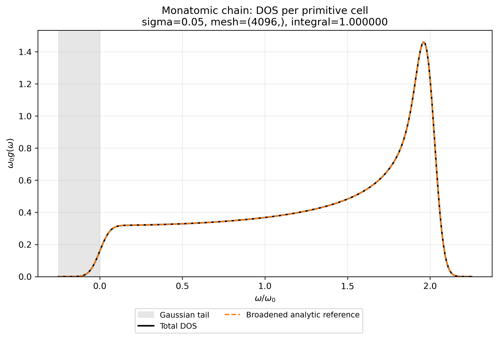

*The numerical DOS reproduces the broadened band-edge peak and agrees with
the independently integrated analytical reference.*

### Diatomic and square-lattice DOS

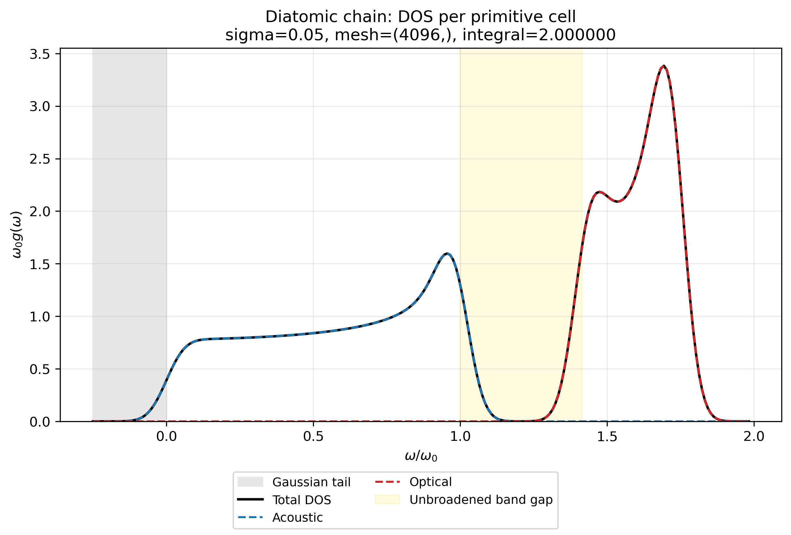

*The acoustic and optical contributions each integrate to approximately one.
For the default masses, the unbroadened gap lies between $1$ and $\sqrt{2}$.
Gaussian tails can extend into this interval without introducing additional
physical modes.*

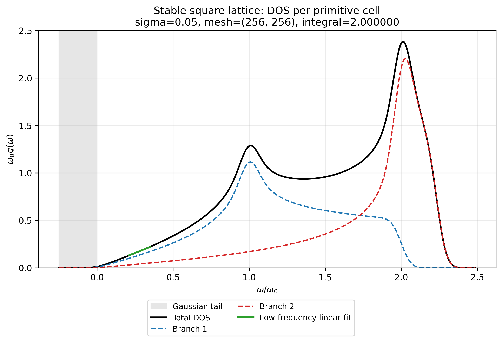

*The two-dimensional DOS uses the stabilized model with $K_2=0.25$. For
linearly dispersing acoustic modes, phase-space counting gives
$g(\omega)\propto\omega^{d-1}$ at low frequency. A two-dimensional model
therefore approaches a linear DOS. The example checks a finite fitting window
$0.20\leq\omega/\omega_0\leq0.35$ to reduce the influence of the Gaussian
boundary tail at zero.*

### Broadening and mesh convergence

The default reference width is $\sigma=0.05\,\omega_0$. The broadening study
compares $\sigma/\omega_0=0.10,0.05,0.02$ on the same final mesh.

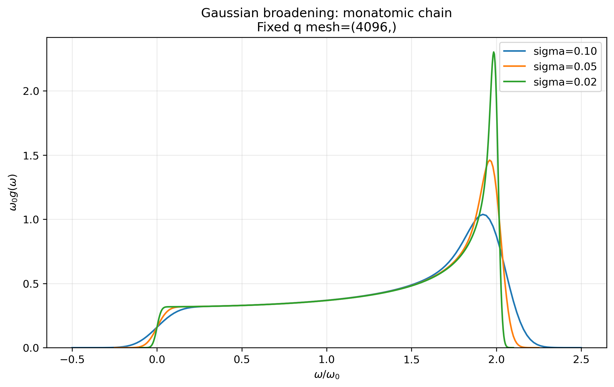

*A smaller width resolves sharper features but requires a denser wavevector
mesh. The width is a numerical smoothing parameter, not a calculated phonon
lifetime or intrinsic linewidth.*

The initial mesh sequences are:

| Model | Initial mesh sequence |
| --- | --- |
| Monatomic chain | $256\rightarrow1024\rightarrow4096$ points |
| Diatomic chain | $256\rightarrow1024\rightarrow4096$ points |
| Stabilized square lattice | $32^2\rightarrow64^2\rightarrow128^2$ points |

The study first checks convergence at the smallest width. If necessary, it
doubles each axis of the finest mesh, with up to two additional refinements.
The default square-lattice study refines to $256\times256$.

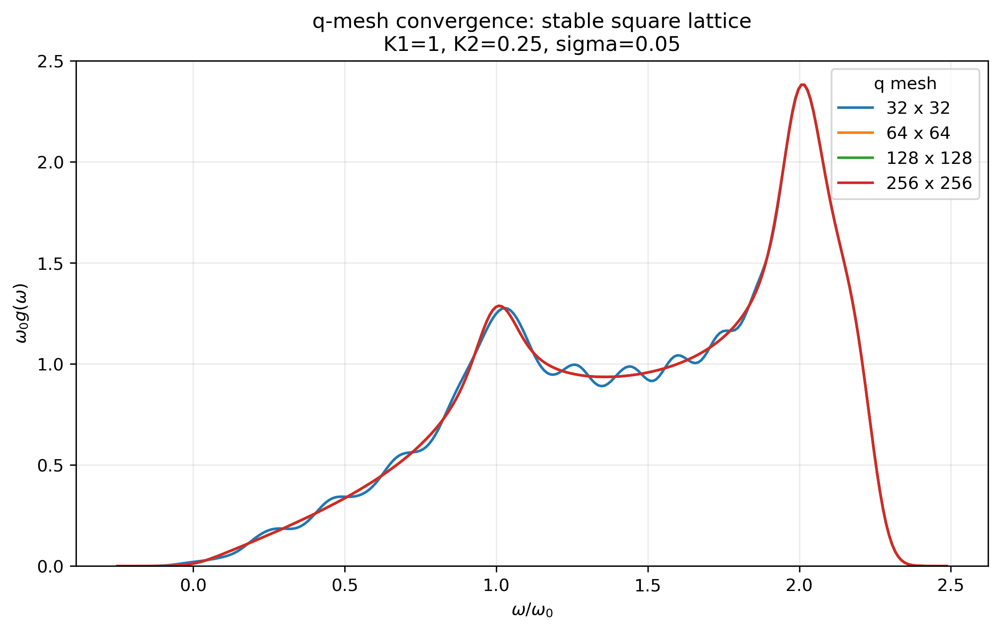

*Mesh convergence is assessed using the integrated absolute difference between
successive curves, normalized by the number of branches. The implementation
also halves the frequency-grid spacing to check the DOS integral separately.*

## Using the numerical modules

The following examples run independently from the repository root. Code
comments and docstrings use English, with Google-style function documentation.

### Calculate a chain dispersion

```python
import numpy as np

from dynamical_matrix import make_diatomic_chain
from dispersion import calculate_dispersion

model = make_diatomic_chain(
    mass_1=1.0,
    mass_2=2.0,
    spring_constant=1.0,
    lattice_constant=1.0,
)
lattice_constant = model.lattice_vectors[0, 0]
wavevectors = np.linspace(
    -np.pi / lattice_constant, np.pi / lattice_constant, 401
)
wavevectors[200] = 0.0

# The general solver expects shape (num_wavevectors, dimension).
result = calculate_dispersion(model, wavevectors[:, None])
print(result.frequencies.shape)  # (401, 2)
print(result.eigenvectors.shape)  # (401, 2, 2)
print(result.frequencies[200])  # Approximately [0, sqrt(3)].

# Columns are modes; divide by square-root masses for physical displacements.
gamma_displacements = (
    result.eigenvectors[200] / np.sqrt(model.dof_masses)[:, None]
)
print(gamma_displacements)
```

The specialized chain examples accept one-dimensional scalar-wavevector
arrays. The general solver always expects a two-dimensional array of shape
`(num_wavevectors, dimension)`, including in one dimension.

### Define a model from force constants

`LatticeModel` supports one- and two-dimensional models. Its force-constant
dictionary maps an **integer cell translation** to a block of shape
`(num_dof, num_dof)`. For example, `(1,)` means one lattice vector, not a
Cartesian distance of one unit. Matrix indices are ordered by atom first,
then by Cartesian component within that atom.

```python
from dynamical_matrix import (
    LatticeModel,
    build_dynamical_matrix,
    solve_modes,
)

spring_constant = 3.0
model = LatticeModel(
    lattice_vectors=[[1.5]],
    basis_positions=[[0.0]],
    masses=[2.0],
    force_constants={
        (0,): [[2 * spring_constant]],
        (1,): [[-spring_constant]],
        (-1,): [[-spring_constant]],
    },
)

dynamical_matrix = build_dynamical_matrix(model, [0.4])
modes = solve_modes(
    dynamical_matrix, eigenvalue_scale=model.eigenvalue_scale
)
print(modes.eigenvalues)
print(modes.frequencies)
print(modes.diagnostics)
```

### Calculate a square-lattice path

```python
from dispersion import calculate_dispersion
from square_lattice import build_square_path, make_square_lattice

model = make_square_lattice(
    mass=1.0,
    nearest_neighbor_spring_constant=1.0,
    lattice_constant=1.0,
    diagonal_spring_constant=0.25,
)
path = build_square_path(lattice_constant=1.0, points_per_axis=101)
result = calculate_dispersion(model, path.q_points)

print(result.frequencies.shape)  # (342, 2)
print(path.tick_indices)  # [0, 100, 200, 341]
print(path.distances[path.tick_indices])
```

### Calculate and integrate a DOS

```python
import numpy as np

from dos import gaussian_dos, integrate_curve, make_frequency_grid, sample_modes
from square_lattice import make_square_lattice

model = make_square_lattice(diagonal_spring_constant=0.25)
samples = sample_modes(model, mesh_shape=(128, 128))
angular_frequencies = make_frequency_grid(
    maximum_frequency=float(np.max(samples.frequencies)),
    broadening_width=0.05,
)
dos_values = gaussian_dos(
    mode_frequencies=samples.frequencies,
    angular_frequencies=angular_frequencies,
    broadening_width=0.05,
    sample_weights=samples.weights,
)
print(integrate_curve(angular_frequencies, dos_values))  # Approximately 2.
```

This example computes one mesh. Use `phonon_dos.py` for the full adaptive
convergence study and its figures.

### Main result containers

| Object | Important fields |
| --- | --- |
| `ModeResult` | `eigenvalues`, `frequencies`, `eigenvectors`, `clipped_negative`, `diagnostics` |
| `DispersionResult` | `q_points`, mode arrays for every wavevector, `diagnostics`, `model_checks` |
| `SquarePath` | `q_points`, cumulative `distances`, `tick_indices`, `labels` |
| `SampledModes` | `mesh_shape`, `q_points`, normalized `weights`, `eigenvalues`, `frequencies` |

`SampledModes` does not retain eigenvectors. Mode sampling is divided into
wavevector batches, and Gaussian evaluation is divided into frequency and
mode blocks to bound temporary memory use. Within each dispersion batch,
`DynamicalMatrixBuilder` prepares geometry, mass factors, and model-dependent
checks once for reuse across wavevectors.

Example parameters are defined in each script's `main()` function. The current
scripts do not provide command-line parameter flags; use the module functions
or edit those local example settings to explore another model.

## Numerical validation

### Eigenvalues and stability

The solver uses `float64` and `complex128`, verifies Hermiticity before calling
`numpy.linalg.eigh`, and preserves the original eigenvalues. It checks the
eigen-equation residual and the orthogonality of the returned eigenvectors.

The eigenvalue tolerance has the form

$$
\tau_\lambda=\mathrm{atol}+\mathrm{rtol}\,\lambda_{\mathrm{scale}},
$$

with default values `atol=1e-12` and `rtol=1e-10`. For a model, the common scale
is the sum of the spectral norms of its mass-normalized real-space blocks,

$$
\lambda_{\mathrm{scale}}
=\sum_{\mathbf R}
\left\|M^{-1/2}\Phi(\mathbf R)M^{-1/2}\right\|_2.
$$

This bounds the assembled matrix norm at every wavevector and supplies a
consistent squared-frequency scale along a path.

| Eigenvalue | Handling |
| --- | --- |
| $\lambda<-\tau_\lambda$ | Raise a dynamical-instability error |
| $-\tau_\lambda\leq\lambda<0$ | Keep the raw eigenvalue, flag it, and use zero for frequency conversion |
| $\lambda\geq0$ | Preserve it and return $\sqrt{\lambda}$, including small positive values |

The solver does not take `sqrt(abs(eigenvalues))` or automatically symmetrize
an incorrectly assembled matrix. Those operations could conceal instability
or a force-constant error.

Near zero, $\omega=\sqrt{\lambda}$ makes frequency errors more sensitive than
eigenvalue errors. Checks therefore distinguish raw eigenvalue accuracy from
frequency accuracy. Extremely small wavevectors can also cause cancellation
in the direct Fourier sum; the scripts check finite long-wavelength intervals
rather than claiming uniform relative accuracy arbitrarily close to zero.

### Built-in checks

| Area | Checks included in the implementation |
| --- | --- |
| Model | Finite real inputs, positive masses, compatible dimensions, reciprocal force blocks, and acoustic sum rule |
| Solver | Hermiticity, negative eigenvalues, eigen-equation residuals, and eigenvector orthogonality |
| Monatomic chain | Special points, full-zone analytical comparison, even symmetry, reciprocal periodicity, finite periodic-chain spectrum, scaling, sound speed, and invalid inputs |
| Diatomic chain | Analytical eigenvalues, Gamma-point displacement relations, zone boundary, equal-mass folding, periodicity, and mass-ratio trends |
| Square lattice | Closed-form matrices, symmetry under axis exchange, nearest-neighbor zero modes, sampled stability, special points, $K_2\rightarrow0$ limit, and directional sound speeds |
| DOS | Mode count, branch-sum consistency, mesh refinement, frequency-step refinement, broadening scans, analytical monatomic reference, and a low-frequency 2D fit |

The default DOS study uses the following acceptance criteria:

| Quantity | Criterion |
| --- | --- |
| Relative total mode-count error | $<10^{-3}$ |
| Successive-mesh $L^1$ difference divided by $\nu$ | $<10^{-2}$ |
| Relative DOS integral change after halving frequency spacing | $<10^{-4}$ |
| Monatomic DOS $L^1$ error against the equally broadened reference | $<10^{-4}$ |
| Analytical reference change from quadrature order 512 to 1024 | $<10^{-6}$ |
| Relative 2D low-frequency linear-fit residual in the selected window | $<0.1$ |

Run the examples normally to execute their checks. Some use Python `assert`
statements, which are disabled by `python -O`; use the ordinary interpreter
when reproducing the validation. Floating-point residuals and runtime can
vary across NumPy versions, linear algebra libraries, and computers.

## Generated figures

All plotting scripts save separate PNG files at **300 dpi**, using a tight
bounding box. The export helper creates `results/figures/` if needed. No SVG
files are generated.

| Script | Output files |
| --- | --- |
| `monatomic_chain.py` | `monatomic_dispersion.png`, `monatomic_frequency_error.png` |
| `diatomic_chain.py` | `diatomic_dispersion.png`, `diatomic_frequency_error.png`, `diatomic_mass_ratio_comparison.png` |
| `square_lattice.py` | `square_lattice_nearest_neighbor_dispersion.png`, `square_lattice_dispersion.png` |
| `phonon_dos.py` | `monatomic_dos.png`, `diatomic_dos.png`, `square_lattice_dos.png`, `monatomic_dos_broadening_comparison.png`, `square_lattice_dos_mesh_convergence.png` |

The images embedded in this README use repository-relative paths so they can
be viewed on GitHub and in local Markdown viewers. The current scripts export
figures; numerical arrays remain available through the result objects rather
than being automatically written to CSV files.

## Scope and limitations

- **Harmonic, ideal periodic models.** Force constants are prescribed model
  parameters. The project does not obtain them from electronic-structure
  calculations or fit them to a particular material.
- **Restricted displacement spaces.** Chains contain longitudinal motion
  only. The square lattice contains in-plane motion only, with no out-of-plane
  flexural branch. The general model currently supports one or two dimensions.
- **No anharmonic dynamics or transport.** The calculations do not include
  phonon scattering, lifetimes, thermal conductivity, or temperature-dependent
  renormalization.
- **Classical normal modes.** Quantizing these harmonic modes gives phonons
  with the same frequencies, but Bose occupation factors and thermodynamic
  observables are not calculated here.
- **Local branch ordering.** Eigenvalues are sorted independently at each
  wavevector. An eigenvector can change its overall complex phase; within a
  degenerate subspace, its basis is not unique. Continuous mode tracking is
  not implemented.
- **Finite numerical resolution.** A DOS curve depends on the wavevector
  mesh, frequency grid, and Gaussian width. The provided convergence study
  is part of interpreting the result.
- **Model-specific shear behavior.** The $K_2=0$ square lattice has extra
  harmonic zero modes. The stabilized $K_2>0$ version is used for the
  two-dimensional DOS study.

## Contributing

Useful contributions include clearer derivations, additional analytically
checkable models, and improvements to convergence analysis or visualization.
For a proposed change, describe the model assumptions, parameter values,
expected behavior, and relevant numerical checks. For an unexpected result,
include the Python and dependency versions, the script or function call, and
the terminal output.

## License

This project is licensed under the MIT License. See [LICENSE](LICENSE)
for the full license text.
